# Manual del administrador · Inventarios

Guía completa de la aplicación **Inventarios** (químicos, material de limpieza y maquinaria) para el perfil **Administrador**: cómo entrar, qué hay en cada sección y cómo dar de alta y mantener los datos de la planta.

> ¿Eres operario o usuario de consulta? El manual de tu perfil está en [manual-usuario.md](manual-usuario.md).

---

## 1. Acceso a la aplicación

1. Abre el navegador (Chrome, Edge, Firefox o Safari) y ve a **https://inventarios.freebuff.app**.
2. Escribe tu **usuario** y tu **contraseña** y pulsa **Entrar**.

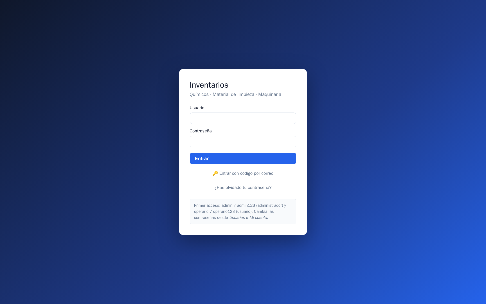

- Tu usuario y contraseña te los facilita el administrador de la instalación. El recuadro inferior de «Primer acceso» es una ayuda de las instalaciones nuevas: en una planta ya en marcha, esas claves de prueba no existen, usa siempre tu cuenta real.
- Si es la primera vez que entras, cambia la contraseña desde **Mi cuenta** (apartado 11).

### Errores frecuentes en el acceso

| Mensaje | Qué significa | Qué hacer |
|---|---|---|
| **Usuario o contraseña incorrectos** | La cuenta no existe o la contraseña no coincide (las mayúsculas importan). | Revisa el usuario y la contraseña. Si olvidaste la contraseña, usa **¿Has olvidado tu contraseña?** |
| **Demasiados intentos fallidos. Inténtalo de nuevo en 15 minutos.** | Por seguridad, 5 fallos en 15 minutos bloquean la cuenta 15 minutos. | Espera 15 minutos o pide a un administrador que te restablezca la contraseña. |
| **Failed to fetch** / **Error de red** | El navegador no ha podido contactar con el servidor. | Comprueba la conexión a internet, cierra el VPN o el firewall corporativo y recarga la página (F5). |
| **Usuario desactivado** | La cuenta está desactivada. | Pide a un administrador que la reactive en **Gestión de centros › Usuarios**. |

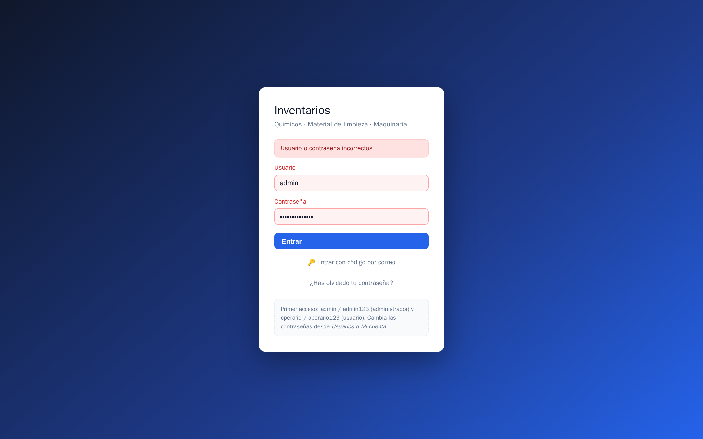

Cuando una validación falla, además del mensaje se **sombrea en rojo claro el campo culpable**; el color desaparece en cuanto lo modificas.

### Otras formas de entrar

- **🔑 Entrar con código por correo**: introduce tu correo y recibirás un código de 8 caracteres (caduca en 10 minutos) para abrir sesión sin contraseña.
- **¿Has olvidado tu contraseña?**: introduce tu correo, verifica el código que llega por correo y elige una contraseña nueva (mínimo 6 caracteres).

---

## 2. La pantalla principal

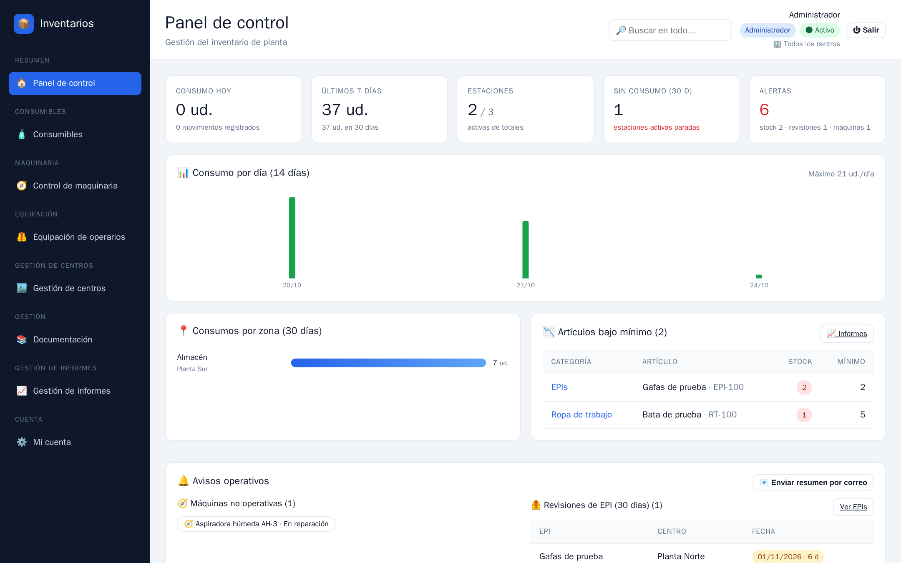

| Zona | Qué contiene |
|---|---|
| **Barra lateral izquierda** | Las secciones: Panel de control, Consumibles, Control de maquinaria, Equipación de operarios, Gestión de centros, Documentación y Gestión de informes. Debajo, **Cuenta › Mi cuenta**. |
| **Cabecera** | 🔎 **Buscar en todo…** (encuentra artículos, zonas, estaciones y usuarios), tu nombre, tu rol, el estado **Activo/Inactivo**, tus centros asignados y el botón **⏻ Salir**. |
| **Zona central** | El contenido de la sección elegida. |

> Consejo: la lupa de la cabecera es la vía rápida. Escribe 2 o más letras y pulsa sobre el resultado para saltar directamente al registro.

---

## 3. Panel de control

- **Tarjetas de resumen (KPI)**: consumo de hoy, últimos 7 días, estaciones activas, estaciones **sin consumo en 30 días** y número de **alertas**.
- **📊 Consumo por día (14 días)**: gráfico de barras con las unidades consumidas cada día.
- **📍 Consumos por zona (30 días)**: ranking de zonas; al pulsar una zona se abren sus estaciones.
- **📉 Artículos bajo mínimo**: stock por debajo del mínimo configurado, con acceso directo a la ficha.
- **🔔 Avisos operativos**: máquinas no operativas, revisiones de EPI próximas/vencidas y químicos vencidos o que caducan en 30 días.
- **🚻 Estaciones sin consumo en 30 días**: enlaces para abrir el modo estación y revisarlas.
- **📧 Enviar resumen por correo** (solo administradores): manda el parte de alertas a los administradores. También se envía automáticamente cada día a las 06:00 UTC.

---

## 4. Consumibles (químicos, material y estaciones)

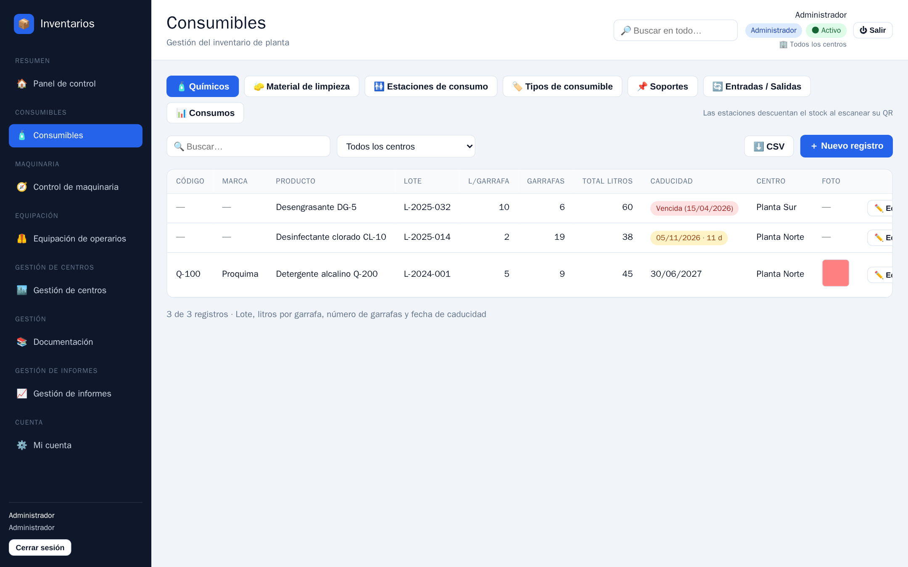

Pestañas disponibles: **Químicos · Material de limpieza · Estaciones de consumo · Tipos de consumible · Soportes · Entradas / Salidas · Consumos**.

En cualquier listado encontrarás:

- **🔍 Buscar…** y el filtro **por centro** (si hay varios centros).
- **⬇️ CSV** para exportar lo que esté filtrado.
- **＋ Nuevo registro** para dar de alta (los campos con **\*** son obligatorios).
- Iconos de fila para **editar**, **borrar** y, cuando aplica, la **etiqueta QR**.

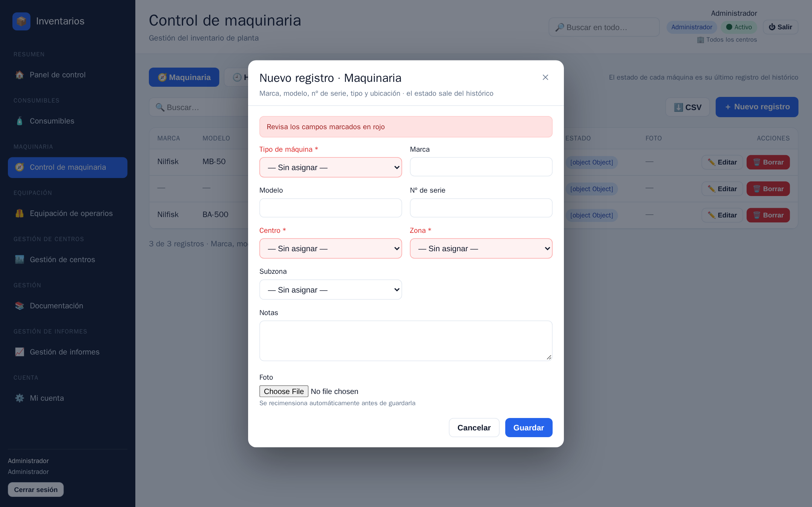

Si pulsas **Guardar** con un campo obligatorio vacío o con un dato inválido, aparece el mensaje de error **y el campo se sombrea en rojo** hasta que lo corrijas.

### 4.1 Entradas / Salidas de stock

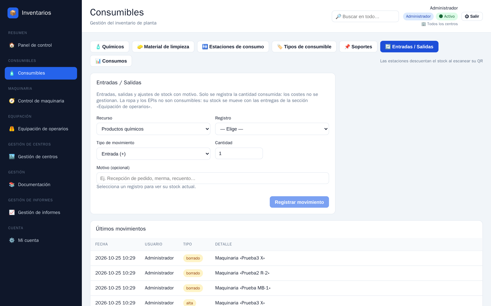

1. Elige el **recurso** (productos químicos o material de limpieza) y el **artículo**.
2. Selecciona el tipo de movimiento: **entrada**, **salida** o **ajuste**.
3. Indica la **cantidad** y un **motivo** (opcional pero recomendado).
4. Pulsa el botón de registrar. El movimiento queda en **Últimos movimientos** y en la auditoría.

### 4.2 Estaciones de consumo (QR)

Las estaciones son los puntos de la planta (zona › subzona › soporte) donde se coloca un artículo. **Al escanear su QR el stock se descuenta automáticamente**.

- **➖ −1 ud** en la lista descuenta una unidad al instante.
- El **QR de la estación** abre el **modo estación** (pantalla grande, apta para tablet en planta):

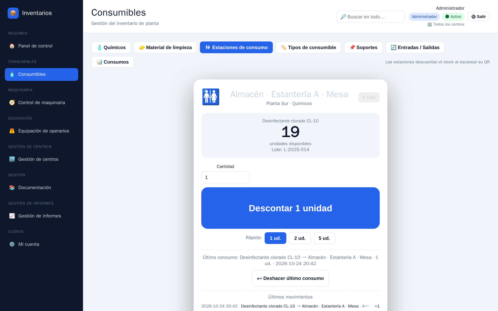

En el modo estación puedes restar unidades con los botones grandes, escanear otro QR (**📷 Escanear otra estación**) y **↩ Deshacer último consumo** si hay un error.

- **🖨️ QR (n)** imprime las etiquetas QR de todas las estaciones filtradas; pégalas en el soporte correspondiente.

---

## 5. Control de maquinaria

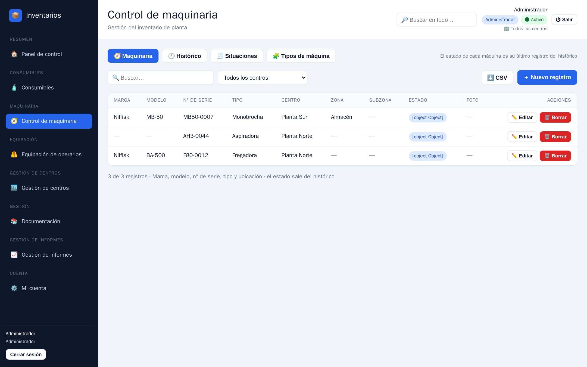

Pestañas: **Maquinaria · Histórico · Situaciones · Tipos de máquina**.

- **Maquinaria**: ficha de cada máquina (marca, modelo, nº de serie, tipo, ubicación y estado). El **estado sale del histórico**: es el último registro.
- **Histórico**: registro de situaciones por máquina (fecha, situación, marca, modelo y centro). Desde aquí se crean y borran registros.

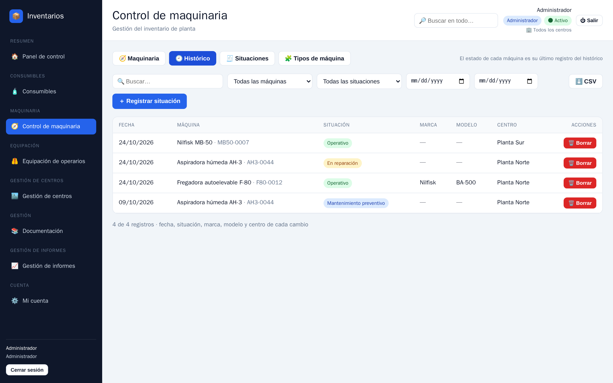

- **＋ Registrar situación** (solo administradores): cambia el estado de la máquina (Operativa, En reparación, Averiada, Baja…).
- **Situaciones** y **Tipos de máquina**: catálogos que después aparecen en los desplegables.

---

## 6. Equipación de operarios

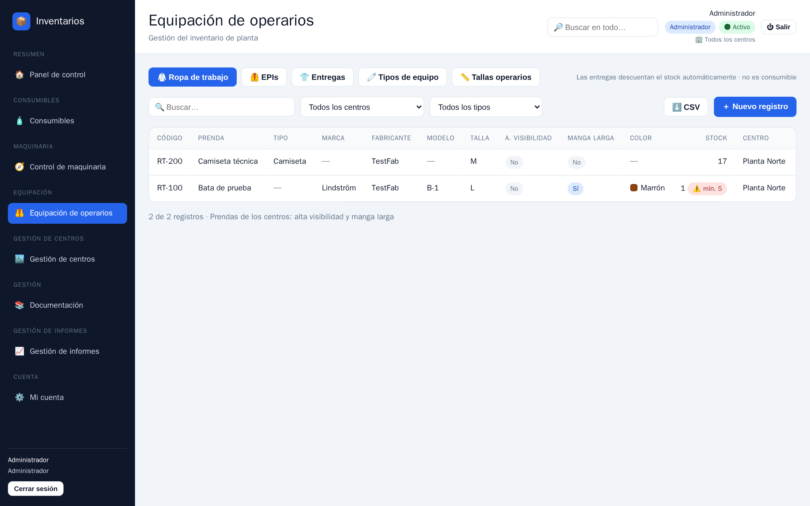

Pestañas: **Ropa de trabajo · EPIs · Entregas · Tipos de equipo · Tallas operarios**.

- **Ropa de trabajo** y **EPIs**: inventario por centro, con talla, color, stock y, en los EPIs, **fecha de revisión** (el panel avisa a los 30 días).
- **Entregas**: registro de entrega de equipación a operarios.

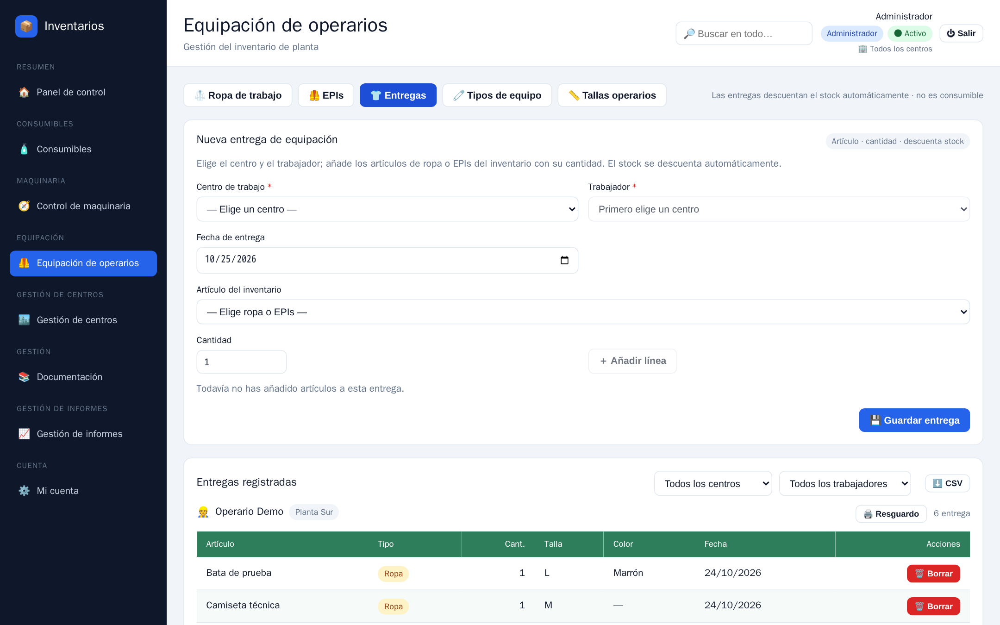

1. Elige el **operario** y el **centro**.
2. Añade las prendas con **＋ Añadir línea** y la cantidad.
3. Guarda: **el stock se descuenta automáticamente** y la entrega queda en el historial (con firma y VoBo en la hoja imprimible).
- **Tipos de equipo** y **Tallas operarios**: catálogos (las tallas son exclusivas de administradores).

---

## 7. Gestión de centros

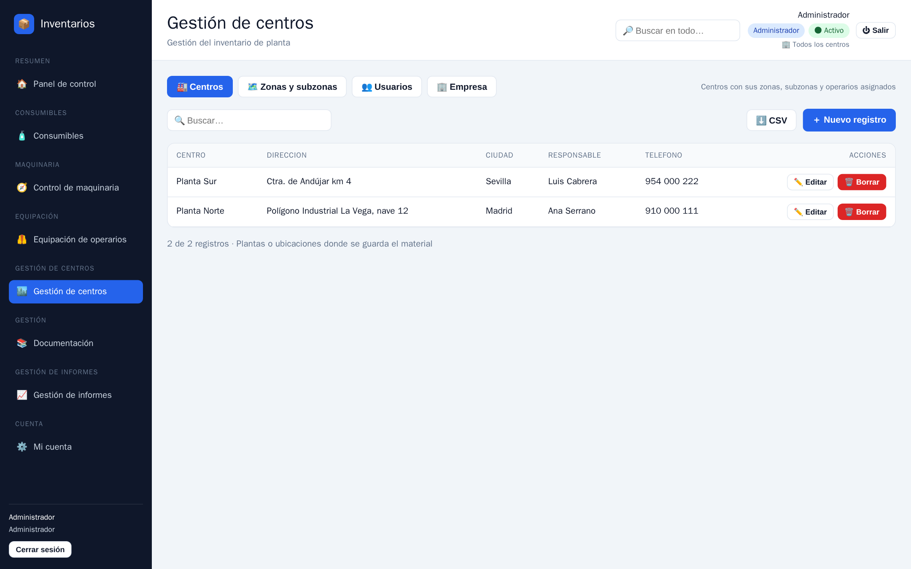

Pestañas: **Centros · Zonas y subzonas · Usuarios · Empresa**.

### Centros
Plantas o ubicaciones (nombre, ciudad, responsable, dirección). Todo lo demás de la app se agrupa por centro.

### Zonas y subzonas
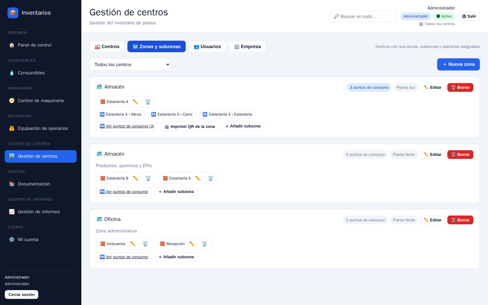
- **＋ Nueva zona** dentro de cada centro y **＋ Añadir subzona** dentro de cada zona.
- Cada zona muestra sus **puntos de consumo (estaciones)** con acceso directo al modo estación.

### Usuarios (solo administradores)
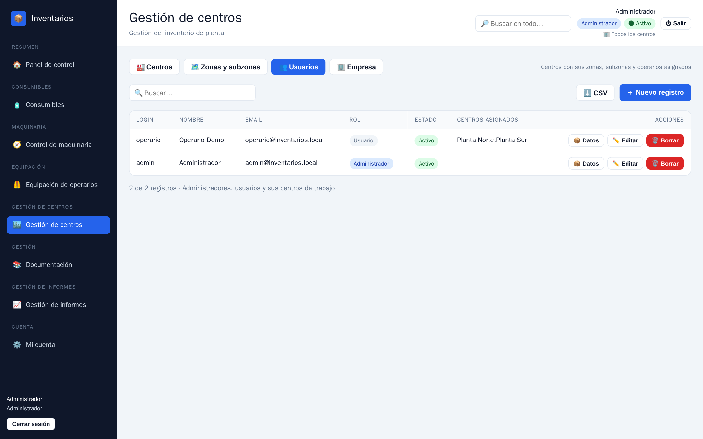

**＋ Nuevo registro** para crear una cuenta:

| Campo | Indicaciones |
|---|---|
| **Usuario (login)** | Nombre corto con el que se entra (sin espacios). |
| **Nombre completo** | Nombre y apellidos que se ven en la cabecera. |
| **Email** | Necesario para entrar con código y para recuperar la contraseña. |
| **Contraseña** | Obligatoria al crear, mínimo 6 caracteres. Al editar, déjala en blanco para conservarla. |
| **Rol** | *Administrador* (todo), *Administrador de centros* (documentación, entregas y sus centros) o *Usuario* (solo lectura). |
| **Activo** | Desmarca para bloquear el acceso sin borrar el histórico. |
| **Centros de trabajo** | Marca uno o varios centros a los que tendrá acceso. |

Para cambiar una contraseña de otro usuario: edita su ficha y escribe una nueva; para desactivarle, desmarca **Activo**.

### Empresa (solo administradores)
Nombre y logotipo de la empresa, que aparecen en las hojas y documentos imprimibles.

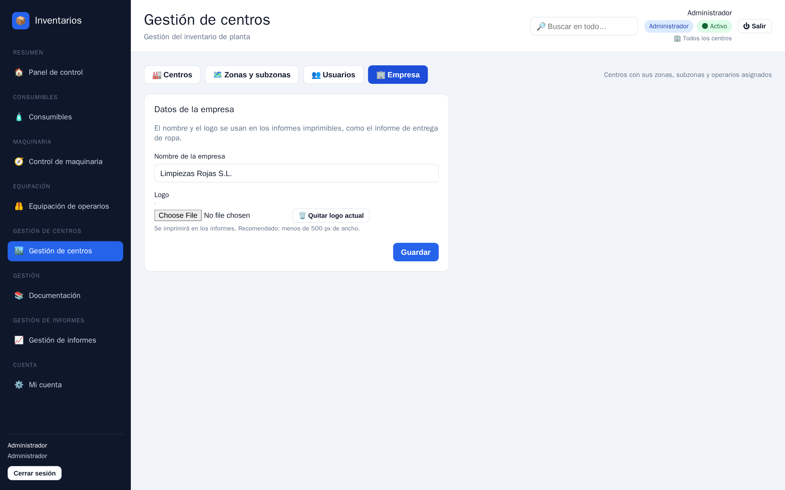

---

## 8. Documentación

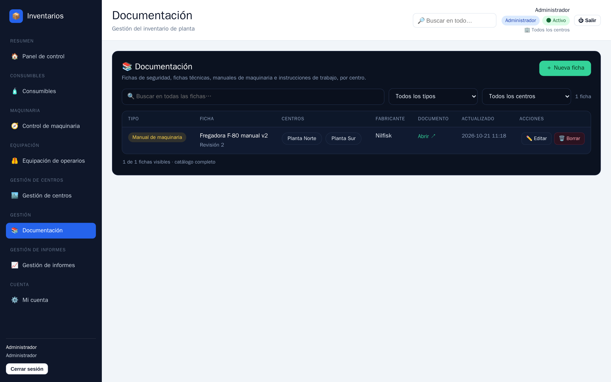

Fichas de documentos (hojas de seguridad, procedimientos, manuales) con **URL**, **tipo de ficha** y **centros** donde se usan.

- **＋ Nueva ficha** y **＋ Nuevo tipo**: disponibles para administradores y administradores de centros; el resto de usuarios solo consulta y abre los documentos.
- Las fichas se filtran por centro y por tipo, y se buscan desde la lupa general.

---

## 9. Gestión de informes

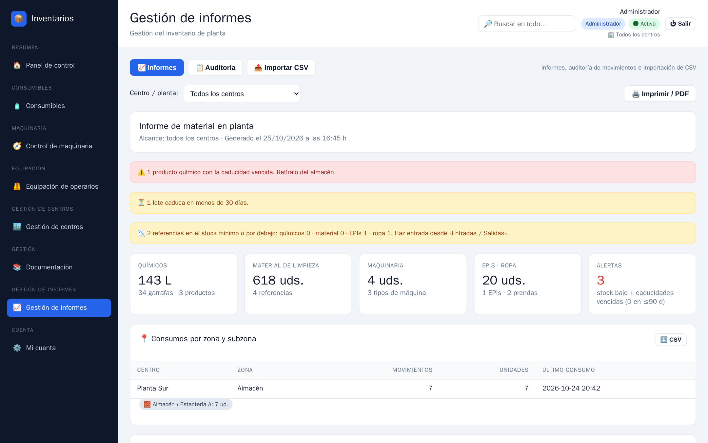

Pestañas: **Informes · Auditoría · Importar CSV**.

### Informes
Bloques con datos listos para exportar: consumos por zona y subzona, entregas por operario, productos químicos, material por color, maquinaria por tipo, EPIs y ropa de trabajo. Cada bloque lleva su botón **⬇️ CSV** y la página completa **🖨️ Imprimir / PDF**.

### Auditoría
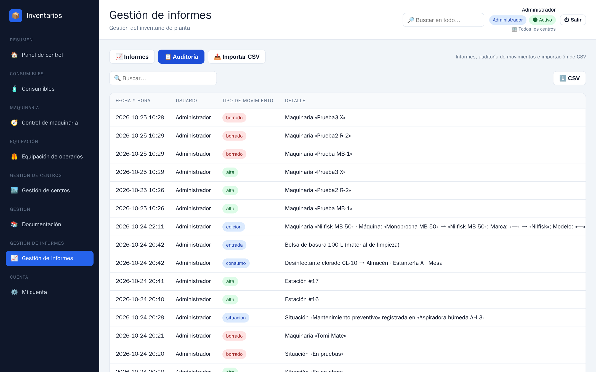
Historial de todos los movimientos de stock (qué, cuánto, cuándo y quién), con búsqueda y exportación a CSV.

### Importar CSV (solo administradores)
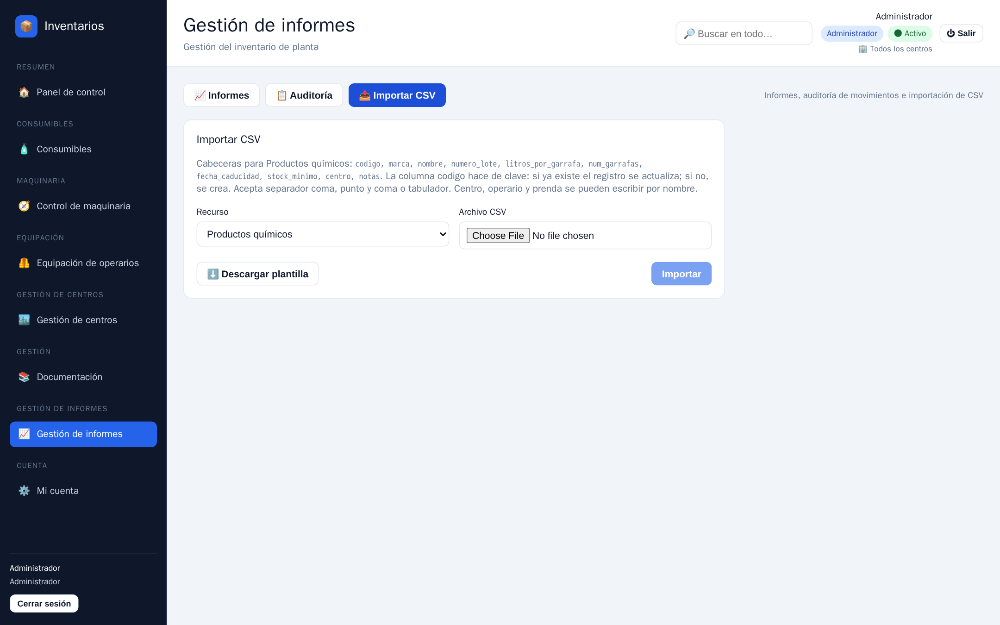
1. Pulsa **⬇️ Descargar plantilla** y rellénala con tus datos.
2. Sube el archivo y revisa la vista previa.
3. Confirma la importación. Los errores se señalan fila a fila antes de guardar nada.

---

## 10. Búsqueda global

Escribe en **🔎 Buscar en todo…** (cabecera) al menos 2 letras. Los resultados muestran la categoría (artículo, zona, estación, usuario…) y al pulsarlos te llevan a su ficha o sección.

---

## 11. Mi cuenta

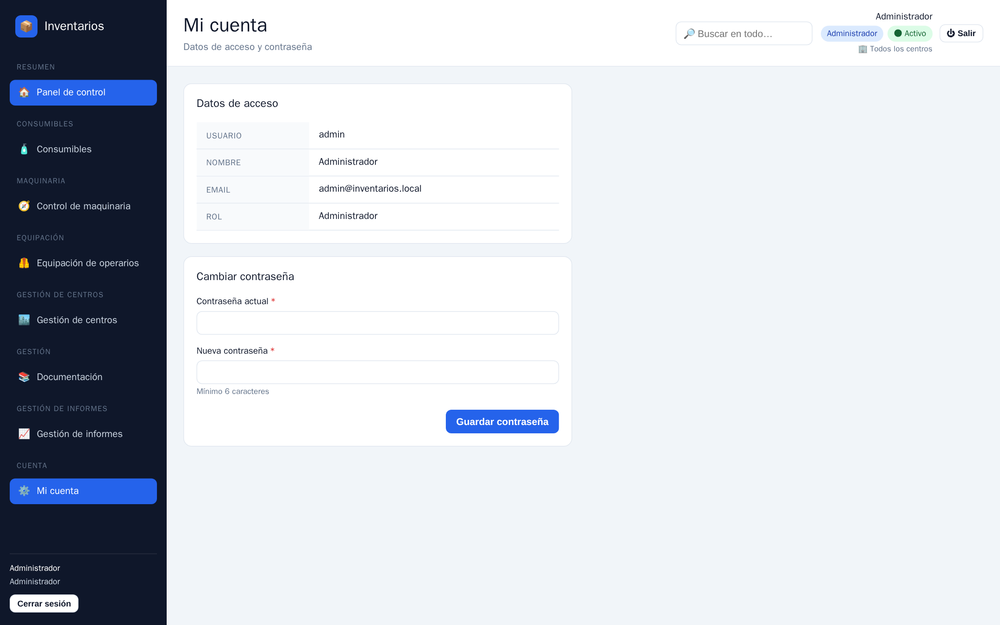

- **Datos de acceso**: usuario, nombre, email y rol (solo consulta).
- **Cambiar contraseña**: introduce la **contraseña actual** y la **nueva** (mínimo 6 caracteres) dos veces. Al guardar, se cierran las demás sesiones abiertas con tu cuenta.

---

## 12. Roles y permisos de un vistazo

| Sección / acción | Administrador | Administrador de centros | Usuario |
|---|:-:|:-:|:-:|
| Consultar inventarios y panel | ✅ | ✅ | ✅ |
| Dar de alta / editar / borrar registros (químicos, material, maquinaria, EPIs, ropa…) | ✅ | — | — |
| Entradas y salidas de stock | ✅ | — | — |
| Registrar situaciones de maquinaria | ✅ | — | — |
| Gestionar zonas y estaciones | ✅ | — | — |
| Crear/editar usuarios, tipos, tallas e importar CSV | ✅ | — | — |
| Centros, documentación y entregas de equipación | ✅ | ✅ (sus centros) | solo lectura |
| Consumir en modo estación (QR) | ✅ | ✅ | ✅ |
| Cambiar su propia contraseña | ✅ | ✅ | ✅ |

---

## 13. Solución de problemas

| Lo que ves | Causa probable | Solución |
|---|---|---|
| **Failed to fetch** al entrar o al guardar | Sin conexión con el servidor (red, proxy o firewall corporativo) | Comprueba internet, desactiva VPN y recarga. Si persiste, prueba desde otra red o desde el móvil. |
| **Usuario o contraseña incorrectos** | Credenciales que no existen en esa instalación | Usa tu cuenta real; si no la recuerdas, **¿Has olvidado tu contraseña?**. |
| Un campo queda **en rojo** | La validación ha marcado ese campo como obligatorio o inválido | Corrige el campo indicado: el color desaparece al escribir. |
| **Sección restringida 🔒** | Tu rol no tiene permisos sobre esa sección | Pide acceso a un administrador. |
| Te salta a la pantalla de acceso | La sesión ha caducado (dura 7 días) o se ha cerrado desde otro dispositivo | Vuelve a entrar. |
| Los datos no se ven actualizados | Caché del navegador | Recarga con **Ctrl/Cmd + F5**. |
| La app abre pero no carga los datos | El «caparazón» está en caché (funciona sin cobertura) pero la API necesita conexión | Recarga la página con internet disponible. |

---

**Consejos finales**

- Cambia tu contraseña en cuanto recibas la primera.
- Usa el **CSV** de cada listado para pasar datos a Excel; usa **🖨️ Imprimir / PDF** en los informes para la documentación en papel.
- Las estaciones sin consumo durante 30 días aparecen en el panel: revisa si siguen instaladas o si hay que reponer el artículo.
