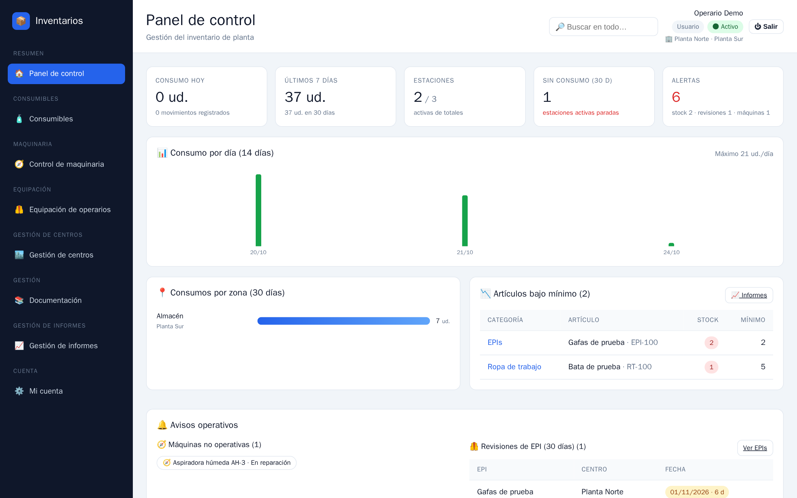
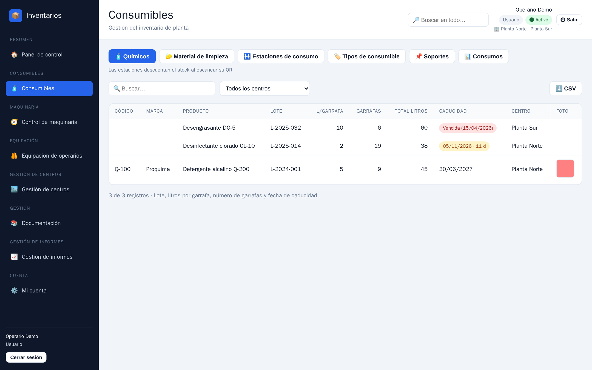
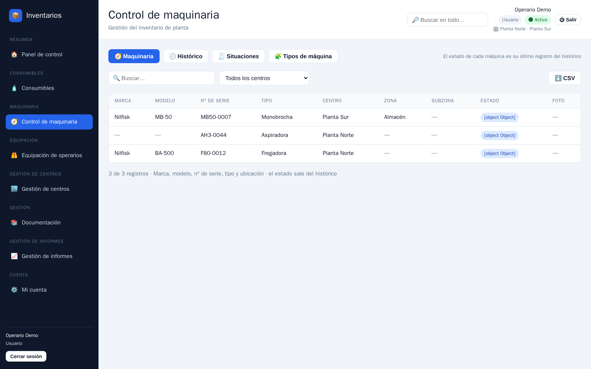
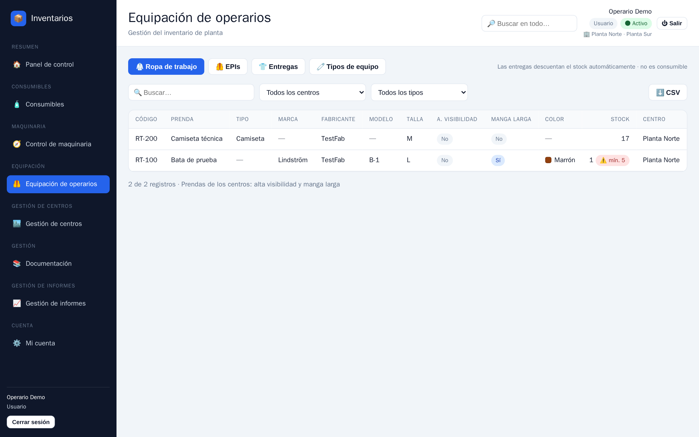
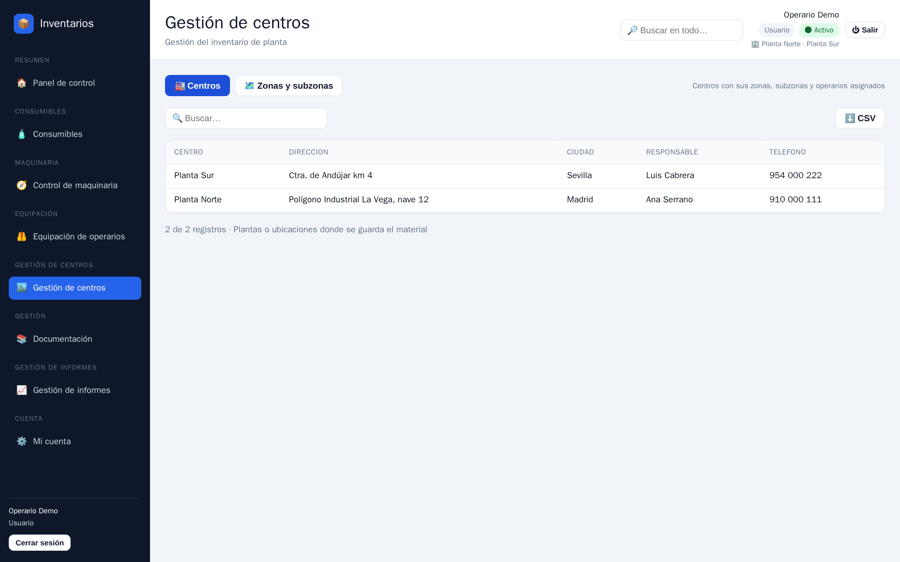
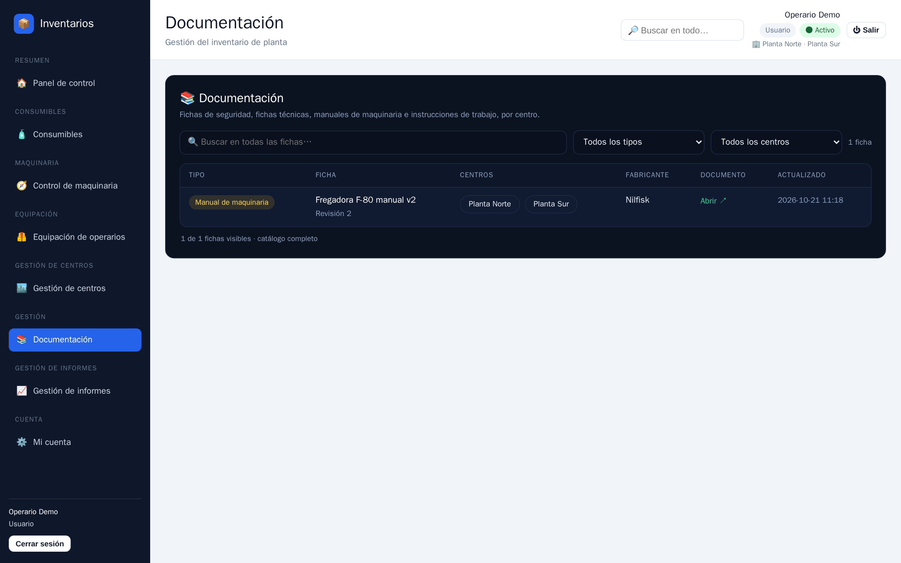
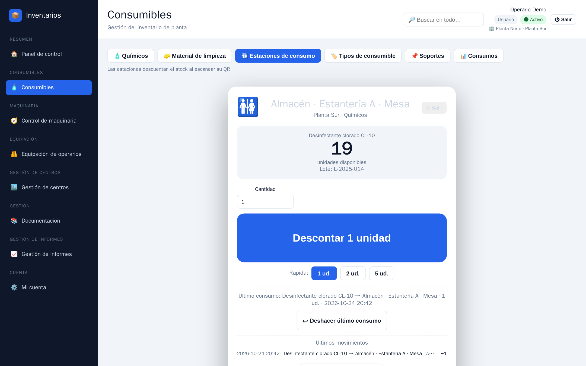
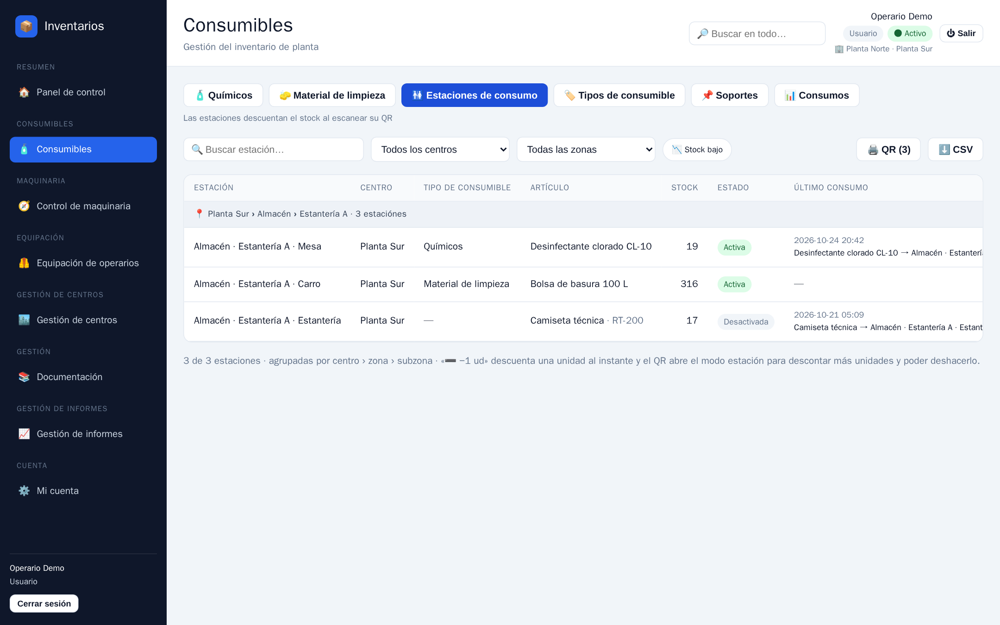
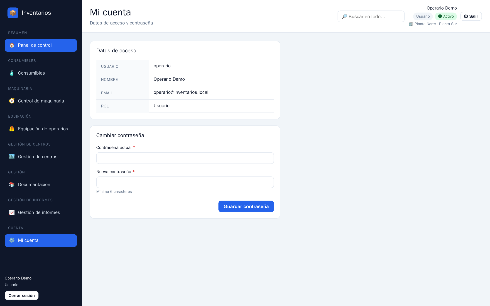

# Manual del usuario · Inventarios

Guía para el perfil **Usuario** (operario) de la aplicación **Inventarios**: cómo entrar, consultar el inventario, consumir material en planta con el QR y gestionar tu cuenta.

> Si eres administrador, consulta el [manual-administrador.md](manual-administrador.md).

---

## 1. Qué puedes hacer y qué no

| Puedes ✅ | No puedes ❌ (solo administradores) |
|---|---|
| Entrar con tu usuario y contraseña | Crear, editar o borrar registros de químicos, material, maquinaria, EPIs o ropa |
| Ver el panel de control y todos los inventarios | Registrar entradas y salidas de stock |
| Buscar en todo con la lupa de la cabecera | Dar de alta usuarios, centros, zonas o tipos |
| **Consumir material en planta escaneando el QR de una estación** | Registrar situaciones de maquinaria o importar CSV |
| Consultar la documentación y abrir los documentos | |
| Cambiar **tu** contraseña | |

Si intentas abrir una sección sin permisos verás un aviso 🔒 **Sección restringida**; simplemente no aparecerán los botones que no te corresponden.

---

## 2. Entrar en la aplicación

1. Abre **https://inventarios.freebuff.app** en el navegador de tu móvil, tablet u ordenador.
2. Escribe tu **usuario** y tu **contraseña** y pulsa **Entrar**.

- Tus credenciales te las da el administrador de la planta. El recuadro «Primer acceso» es una ayuda de instalaciones nuevas; en tu planta usa siempre tu cuenta.
- **¿Has olvidado tu contraseña?** → introduce tu correo, escribe el código que te llega por correo (caduca en 10 minutos) y elige una contraseña nueva de al menos 6 caracteres.
- **🔑 Entrar con código por correo**: si tu cuenta tiene correo, puedes entrar sin contraseña recibiendo un código de 8 caracteres.

### Si algo va mal al entrar

| Mensaje | Qué hacer |
|---|---|
| **Usuario o contraseña incorrectos** | Comprueba mayúsculas y tu usuario real. Tras 5 fallos en 15 minutos la cuenta se bloquea 15 minutos. |
| **Failed to fetch** | No hay conexión con el servidor: revisa internet, apaga el VPN y recarga (F5). |
| **Usuario desactivado** | Pide a un administrador que reactive tu cuenta. |

Cuando un dato no es válido, la aplicación muestra el mensaje de error **y pinta en rojo claro el campo** que hay que corregir; el color desaparece en cuanto escribes.

---

## 3. La pantalla principal

- **Barra lateral**: Panel de control, Consumibles, Control de maquinaria, Equipación de operarios, Gestión de centros, Documentación y Gestión de informes. Abajo, **Cuenta › Mi cuenta** y el botón **Cerrar sesión**.
- **Cabecera**: 🔎 **Buscar en todo…**, tu nombre, tu rol (**Usuario**), tu estado y los centros asignados. Pulsa **⏻ Salir** para cerrar la sesión.
- Los datos se agrupan por **centro**: si trabajas en varios, usa el filtro de centro de cada listado.

---

## 4. Panel de control

- **Consumo de hoy**, **últimos 7 días**, **estaciones activas** y **alertas**.
- **📊 Consumo por día (14 días)** y **📍 Consumos por zona (30 días)**: pulsa una zona para ver sus estaciones.
- **📉 Artículos bajo mínimo**: lo que hay que reponer.
- **🔔 Avisos operativos**: máquinas no operativas, revisiones de EPI y químicos por caducar.

---

## 5. Consultar los inventarios

Todas las secciones de consulta comparten los mismos controles: **🔍 Buscar…**, filtro **por centro**, **⬇️ CSV** (exportar) y, en las filas, el icono de **ver detalle**.

### Consumibles

Pestañas: **Químicos · Material de limpieza · Estaciones de consumo · Tipos de consumible · Soportes · Consumos**. Aquí ves lotes, litros por garrafa, número de garrafas, fecha de caducidad y stock por centro.

### Control de maquinaria

Pestañas: **Maquinaria · Histórico · Situaciones · Tipos de máquina**. El estado de cada máquina es su último registro del histórico (Operativa, En reparación, Averiada…).

### Equipación de operarios

Pestañas: **Ropa de trabajo · EPIs · Entregas · Tipos de equipo**. Consulta el stock de prendas y EPIs y las entregas ya realizadas.

### Gestión de centros y documentación

- **Centros** y **Zonas y subzonas**: la estructura de la planta y sus puntos de consumo.
- **Documentación**: abre las fichas y documentos compartidos (hojas de seguridad, procedimientos…).

---

## 6. Consumir material en planta (modo estación)

Es la acción principal de un operario: descontar unidades de un artículo al usarlo.

**Opción A · Escanear el QR con el móvil**
1. Apunta la cámara al **QR de la estación** (etiqueta pegada en el soporte).
2. Se abre la pantalla grande del **modo estación**:

3. Pulsa el botón grande para **descontar unidades**; verás el stock actualizado.
4. Si te equivocas, pulsa **↩ Deshacer último consumo**.
5. **📷 Escanear otra estación** permite continuar con el siguiente punto sin salir.

**Opción B · Desde la lista**
1. Ve a **Consumibles › Estaciones de consumo**:

2. Pulsa sobre la estación (o usa el botón **➖ −1 ud** para descontar una unidad al instante).

> El consumo queda registrado con fecha y usuario, y actualiza el panel y los informes al momento.

---

## 7. Mi cuenta

1. **Datos de acceso**: tu usuario, nombre, correo y rol (solo consulta).
2. **Cambiar contraseña**: escribe tu **contraseña actual**, la **nueva** (mínimo 6 caracteres) y repítela. Al guardar, se cierran las demás sesiones abiertas con tu cuenta.

---

## 8. Solución de problemas

| Lo que ves | Causa probable | Solución |
|---|---|---|
| **Sección restringida 🔒** o no ves ciertos botones | Tu rol es de solo lectura | Es normal: pide a un administrador cualquier alta o modificación. |
| **Failed to fetch** | Sin conexión con el servidor | Revisa internet/VPN y recarga (F5). |
| **Usuario o contraseña incorrectos** | Credenciales equivocadas o bloqueo de 15 minutos | Usa tu cuenta real o recupera la contraseña desde el enlace de acceso. |
| Un campo en **rojo** | Ese campo es obligatorio o tiene un dato inválido | Corrige el campo marcado: el rojo desaparece al escribir. |
| El QR no abre la estación | Cámara bloqueada o enlace copiado a medias | Abre la lista **Consumibles › Estaciones de consumo** y pulsa la estación. |
| Te salta a la pantalla de acceso | La sesión caducó (dura 7 días) | Vuelve a entrar. |
| Los datos no cambian | Caché del navegador | Recarga con **Ctrl/Cmd + F5**. |

---

**Recuerda**: la aplicación funciona también sin cobertura para abrirse (es una PWA), pero **los datos necesitan conexión**. Si vas a una zona sin wifi, abre la pantalla que necesites antes de salir.
